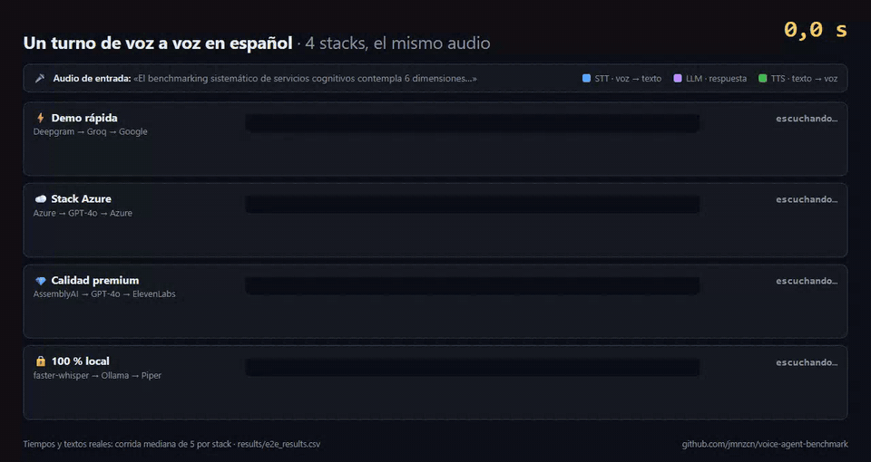

# Voice Agent Benchmark

[](https://github.com/jmnzcn/voice-agent-benchmark/actions/workflows/test.yml)


Which speech-to-text, language model and text-to-speech services should a Spanish-speaking voice
agent use? I measured 15 of them, 12 in the cloud and 3 running locally, on latency, accuracy, cost,
privacy, customization and integration effort. Then I built 4 complete voice-to-voice stacks to see
what one real turn of conversation looks like end to end.



<sub>A replay of a real turn: stage timings, transcripts and answers come from [`results/e2e_results.csv`](results/e2e_results.csv) (the median of 5 runs per stack; after 10 s the clock speeds up ×8).</sub>

There is an [interactive results page](https://jmnzcn.github.io/voice-agent-benchmark/) (in Spanish)
where you can put together your own stack and see what a turn would take and cost, compare the 15
services call by call, and read what each stack heard and answered.

## Results


| Stack (STT → LLM → TTS) | Latency per turn | Cost per turn | Good for |
|---|---:|---:|---|
| Deepgram → Groq → Google | 1.8 s | $0.0072 | demos and low-latency production |
| Azure → GPT-4o → Azure | 7.8 s | $0.0087 | companies already on Azure |
| AssemblyAI → GPT-4o → ElevenLabs | 9.0 s | $0.0877 | the most natural voice |
| faster-whisper → Ollama → Piper | 62.0 s | $0 | data that can't leave the machine |

25 turns per stack (5 audio clips × 5 runs). What I found:

1. The fastest stack was also the cheapest. Deepgram, Groq and Google answered in 1.8 s per turn,
   about 5 times faster and 12 times cheaper than the premium stack. Paying more did not buy a
   better conversation.
2. Local speech-to-text almost matched the best cloud service. faster-whisper large-v3 had a 5.0 %
   word error rate, against 4.7 % for AssemblyAI, at no API cost. The price is time: about 37 s per
   clip on a 4 GB GPU.
3. Groq was by far the fastest language model: 695 ms on average and 227 ms to the first token,
   about 2.5 times faster than GPT-4o and 9 to 10 times faster than Claude Sonnet 4.6 or Gemini 2.5
   Flash.
4. Not every model follows a JSON schema. OpenAI, Anthropic and Groq returned valid JSON every time,
   Ollama (Llama 3.2 3B) 80 % of the time and Gemini 2.5 Flash only 60 %.
5. Text-to-speech prices vary a lot. ElevenLabs sounded the most natural (5 out of 5) but costs about
   19 times as much as Google Neural2, which was also the fastest at 300 ms.
6. Running everything locally works for privacy, not for real-time conversation on modest hardware:
   62 s per turn, 78 % of it in speech-to-text.

<table>
<tr>
<td width="50%"></td>
<td width="50%"></td>
</tr>
<tr>
<td align="center"><sub>LLM: latency vs. cost per call</sub></td>
<td align="center"><sub>STT: average word error rate (lower is better)</sub></td>
</tr>
</table>

### All 15 services

| Type | Service | Model | Avg. latency | Quality | USD per call | Privacy (1–5) |
|---|---|---|---:|---|---:|:---:|
| LLM | Groq | llama-3.3-70b-versatile | 695 ms | JSON 100 % · coherence 4/5 | 0.0002 | 4 |
| LLM | OpenAI | gpt-4o | 1,781 ms | JSON 100 % · coherence 5/5 | 0.0020 | 3 |
| LLM | Google | gemini-2.5-flash | 5,928 ms | JSON 60 % · coherence 4/5 | 0.0008 | 3 |
| LLM | Anthropic | claude-sonnet-4-6 | 6,916 ms | JSON 100 % · coherence 5/5 | 0.0057 | 4 |
| LLM | Ollama (local) | llama3.2:3b | 36,643 ms | JSON 80 % · coherence 3/5 | 0 | 5 |
| STT | Deepgram | nova-3 | 429 ms | WER 6.6 % | 0.0013 | 3 |
| STT | OpenAI | whisper-1 | 2,127 ms | WER 6.5 % | 0.0018 | 3 |
| STT | AssemblyAI | universal-3-pro | 4,218 ms | WER 4.7 % | 0.0011 | 3 |
| STT | Azure | speech-recognition-standard | 6,892 ms | WER 7.1 % | 0.0049 | 3 |
| STT | faster-whisper (local) | large-v3 | 37,482 ms | WER 5.0 % | 0 | 5 |
| TTS | Google | es-ES-Neural2-A | 300 ms | naturalness 4/5 | 0.0027 | 3 |
| TTS | Azure | es-CR-MariaNeural | 849 ms | naturalness 4/5 | 0.0027 | 3 |
| TTS | ElevenLabs | eleven_multilingual_v2 | 2,148 ms | naturalness 5/5 | 0.0512 | 3 |
| TTS | Piper (local) | es_ES-davefx-medium | 3,026 ms | naturalness 3/5 | 0 | 5 |
| TTS | OpenAI | gpt-4o-mini-tts | 3,369 ms | naturalness 4/5 | 0.1024 | 3 |

More detail (time to first token, error rate by audio source, MOS, customization, integration) is in
[`docs/dimensiones_datos/`](docs/dimensiones_datos/), and every chart is in
[`docs/graficos_generados/`](docs/graficos_generados/).

## Which one to pick

- If it has to feel like a conversation: Deepgram, Groq and Google TTS.
- If the voice matters most (branding, narration): ElevenLabs, with GPT-4o or Claude for reasoning.
- If you need reliable structured output (tool calling, JSON): GPT-4o, Claude or Groq.
- If the data can't leave the organization: faster-whisper, Ollama and Piper, on a stronger GPU than
  the one I had.
- If you're already on Azure: the Azure stack costs about the same as the fast one, with more latency.

## How I measured

Every input ran 5 times. The language models got 5 prompts, one of them requiring strict JSON;
text-to-speech got 5 texts; speech-to-text got 14 Spanish audio clips, checked by SHA-256 so every
service heard exactly the same files. The 4 end-to-end stacks each ran on 5 clips.

Latency is the total time per call, plus time to first token for streamed language models.
Speech-to-text accuracy is word error rate with `jiwer`. For the language models I checked JSON
validity and rated coherence by hand. For text-to-speech I rated naturalness by listening and
measured intelligibility by transcribing the audio back. Costs use the public prices in
[`common/rates.py`](common/rates.py), and privacy, customization and integration are scored 1 to 5
with the criteria in [`analysis/dimensions_catalog.py`](analysis/dimensions_catalog.py).

The local services ran on Windows 11 with 12 logical CPUs, 32 GB of RAM and an NVIDIA Quadro P2000
(4 GB). A current GPU would change the local numbers a lot.

Limits: it is one run from Costa Rica, so cloud latency includes the network; the naturalness and
coherence ratings are mine alone; and prices change. The raw CSVs are in [`results/`](results/) so
anyone can check or redo the analysis.


## Run it

You need Python 3.11+, Git and FFmpeg. For the local services: Ollama with `llama3.2:3b`, ideally a
GPU for faster-whisper, and Piper configured through the `PIPER_*` variables in `.env.example`. A
provider without an API key is skipped and the rest still run.

```powershell
git clone https://github.com/jmnzcn/voice-agent-benchmark.git
cd voice-agent-benchmark
python -m venv .venv
.venv\Scripts\Activate.ps1
pip install -r requirements.txt
copy .env.example .env   # fill in the keys you have
python scripts/bootstrap.py
```

To rebuild every table and chart from the committed CSVs, without spending API credits:

```powershell
python scripts/run_analysis.py
```

The full run calls the APIs and takes a while locally:

```powershell
python -m run_all 5
python scripts/validate_results.py
python scripts/run_analysis.py
```

<details>
<summary>Other commands</summary>

```powershell
python -m run_all 5 --skip-e2e
python -m benchmarks.pipeline.run_e2e 5
python scripts/dedupe_results.py      # if you re-ran inputs without reset_results
python scripts/reset_results.py
python scripts/run_analysis.py --with-optional   # recompute intelligibility with Whisper on CPU (slow)
python scripts/smoke_analysis.py
python scripts/build_site_data.py     # rebuild docs/site/data.json for the interactive page
python -m pytest tests/ -q
```

To regenerate the test audio from scratch, see [`data/test_audio/README.md`](data/test_audio/README.md).
</details>

The code is organized as `run_all.py` (the entry point), `benchmarks/` (llm, stt, tts and the
end-to-end pipeline), `common/` (prompts, texts, prices), `analysis/` (aggregation and charts),
`data/` (the 14 clips and reference transcripts), `results/` (the CSVs) and `examples/` (a C#
client for Unity). API keys live only in `.env`, which is git-ignored, and `bootstrap.py` warns if
it ever gets tracked.

## Background

This was project 2 of PF-3312, Intelligent Virtual Agents Lab (Dr. Alexander Barquero), in the
graduate program in Computer Science at the University of Costa Rica, first semester of 2026. The
full report (in Spanish) is [`docs/informe_PF3312_Proyecto2_B03230.pdf`](docs/informe_PF3312_Proyecto2_B03230.pdf).
The services belong to their providers, and FLEURS, Common Voice and the other datasets cited have
their own licenses. I used ChatGPT and Claude to help organize ideas and review the writing; the
experiment design, measurements, analysis and conclusions are mine.

## Resumen en español

Medí 15 servicios de voz y lenguaje (12 en la nube y 3 locales) para un agente de voz en español, en
latencia, precisión, costo, privacidad, customización e integración, y armé 4 stacks completos de
voz a voz. El más rápido también fue el más barato: Deepgram, Groq y Google respondieron en 1,8 s por
turno a $0,007, unas 5 veces más rápido y 12 veces más barato que el stack premium. El reconocimiento
de voz local (faster-whisper) casi empató con el mejor de la nube, con un WER de 5,0 % contra 4,7 %.
Todo se puede reproducir: los CSV crudos, los audios verificados con SHA-256 y los scripts que
regeneran cada tabla y gráfico sin gastar créditos.

## License

[PolyForm Noncommercial 1.0.0](LICENSE). You can read, run and modify it for noncommercial purposes,
including evaluating it for a job. Commercial use needs a license from me:
[neyfred@gmail.com](mailto:neyfred@gmail.com).

Ney Fred Jiménez Campos · [LinkedIn](https://www.linkedin.com/in/neyfred/) · [GitHub](https://github.com/jmnzcn)
